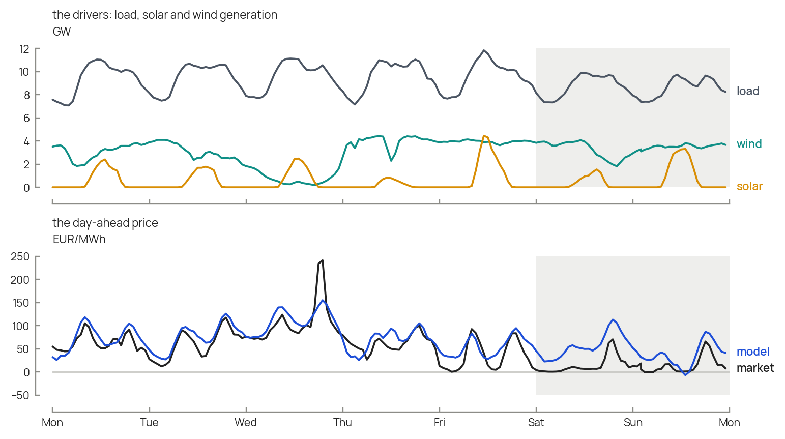
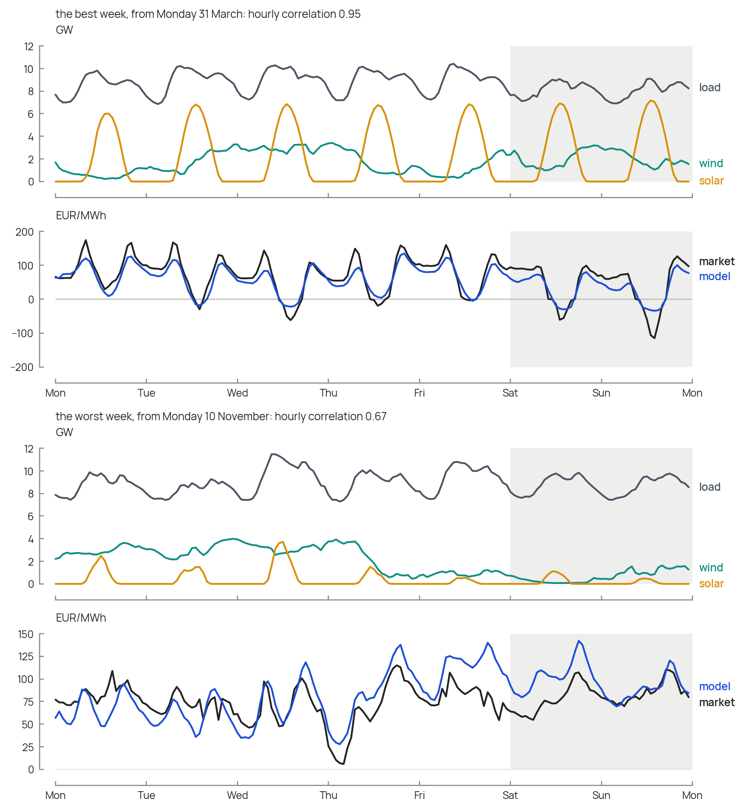

<p align="center" markdown>
{ width="440" }
{ width="440" }
</p>

**A parametric model of hourly electricity prices, for scenario sweeps,
uncertainty propagation and future years.**

`pricecast` turns hourly load, solar and wind generation into a full year of
hourly day-ahead prices, in one shot. The model is a regression fitted on market
years, so its prices respond to the drivers as real prices have: a larger solar
fleet deepens the midday trough on sunny days and not on overcast ones. Each
year takes a fraction of a second, which makes the model an *input* for LP and
MILP design studies - a heat pump with storage, a battery, PV, an electrolyser -
and for the many price years that a sweep or an uncertainty propagation needs.



*From a week's load, solar and wind, the model rebuilds the week's prices. This
is the median week of 2025 in Belgium, not a chosen one: ranked by how closely
the model's hourly prices follow the market's, 2025's 51 full weeks put this
one, from Monday 20 October, in the middle, at a correlation of 0.85. The
drivers from ENTSO-E above, the market's day-ahead price and the model's below,
with the weekend shaded. The model was fitted on 2023 and 2024, so 2025 is new
to it.*



*Even in its worst week the model keeps the daily rhythm; where it misses, the
drivers show why. The best and the worst of the 51 weeks, by the same ranking.
In the best, from Monday 31 March (correlation 0.95), sun and wind come in a
steady daily pattern and the model follows every swing, stopping short only of
the market's deepest negative prices. In the worst, from Monday 10 November
(0.67), Belgium's wind falls from about 3.5 GW to below 1 GW on Thursday
afternoon and stays low until Sunday. The model reads a tight system and prices
Friday and Saturday about 30 EUR/MWh above the market (daily means 111 and 104
against 80 and 77). It sees only Belgium's own load, solar and wind, while the
market price is set across coupled European markets; most likely, supply from
the neighbours covered the gap.*

The model supplies the hourly shape; a scenario supplies the rest. For a future
year, ENTSO-E's TYNDP 2026 scenarios give the fleet, the demand and the price
level, and their hourly results can serve as the model's training data. It is
not a forecaster and not a market model: it does not predict a given hour, and
it does not dispatch storage or demand response.

```bash
pip install pricecast
pip install "pricecast[entsoe]"    # to download market data from ENTSO-E
```

- [Usage](usage.md): fitting, generating, checking a year's structure.
- [Recipe](recipe.md): a future year from TYNDP, step by step, with the source
  of every input.
- [Sweeps and uncertainty](uncertainty.md): one driver at a time, sampled
  scenarios, and which inputs matter.
- [Mathematics](mathematics.md): the model, the residual process, the level,
  the floor and the reach, with every symbol defined.

Does your study need hourly energy demand as well as prices? Its sister
project, [`loadcast`](https://loadcast.readthedocs.io/en/latest/), by the same
authors, turns a few numbers from an industrial site's energy bill into a year
of hourly heat, cold and electricity demand, with the coupling between the
carriers as an input.
