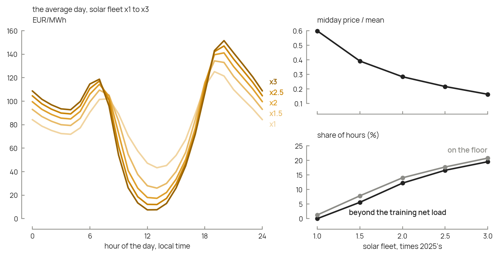
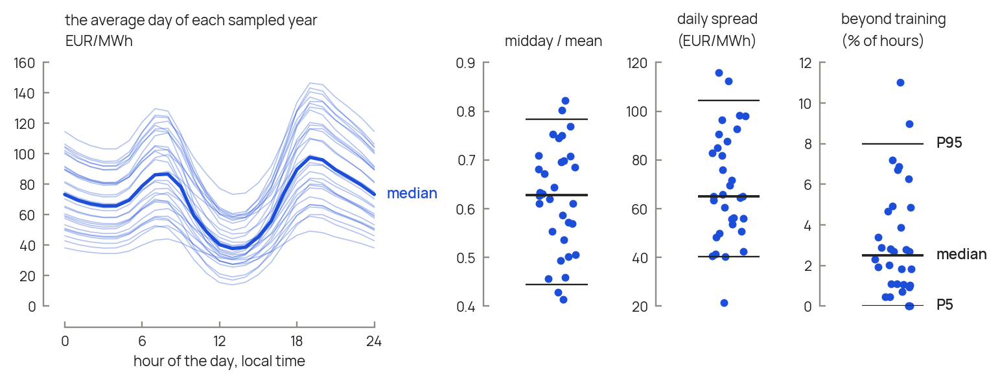

# Sweeps and uncertainty propagation

A market model produces one price year per run; `pricecast` produces one per
set of drivers, in a fraction of a second. Two kinds of study become cheap:
sweeping one driver to see what it does to the year, and sampling a scenario's
uncertain inputs to see what they do to a design. `examples/03_uncertainty.py`
runs the second for Belgium in 2035.

## One driver at a time

Scaling one driver while holding the others shows what that driver does to the
shape of the year. Here Belgium's solar fleet grows from today's to three times
today's, at a fixed price level:

```python
import pandas as pd
import pricecast
from pricecast.entsoe import fetch_year

(p24, d24), (p25, d25) = fetch_year("BE", 2024), fetch_year("BE", 2025)
model = pricecast.load("BE")
training = pd.concat([d24, d25])
floor = pricecast.training_floor(pd.concat([p24, p25]))

rows = {}
for solar in (1.0, 1.5, 2.0, 2.5, 3.0):
    future = pricecast.scale_drivers(d25, solar=solar)
    year = pricecast.rescale_to_level(model.predict(future), level=p25.mean(), floor=floor)
    rows[solar] = {**pricecast.structure_metrics(year, solar=future["solar"]),
                   "beyond training (%)": pricecast.share_beyond_training(future, training)}
pd.DataFrame(rows).T
```

Holding the level fixed isolates the shape. Read every row with its reach count:
as solar grows, a rising share of hours lies beyond the training net load, where
the model extrapolates its trough linearly and the floor then stops it.



*More solar deepens the midday trough, by less at each step, and pushes ever
more hours beyond the model's reach: one in eight at twice today's fleet. The
code above, on 2025's weather and level with the shipped model. Right: the
midday price over the mean, which falls from 0.60 to 0.16, and the two reach
counts, the hours whose net load lies below anything in the training years and
the hours on the floor.*

## Sampling a scenario's uncertain inputs

A scenario gives a range for each input, and sampling those ranges gives one
price year per sample. TYNDP 2026 gives ranges for two inputs: its higher- and
lower-growth variants (HEV, LEV) change the demand and the price level in 2035
and 2040, while keeping the central scenario's fleet. The timing of the build-out
has no range of its own in TYNDP; one choice is the central fleet five years
early to five years late. For Belgium in 2035:

| input | low | central | high | from |
|---|---|---|---|---|
| solar capacity (GW) | 15.6 | 20.1 | 29.5 | the NT+ fleet of 2030, 2035 and 2040 |
| wind capacity (GW) | 7.8 | 13.0 | 17.6 | the same |
| annual demand (TWh) | 122.7 | 133.4 | 145.3 | LEV, NT+ and HEV |
| price level (EUR/MWh) | 38.0 | 67.4 | 109.3 | NT+'s mean without scarcity hours, times the ratios of LEV's and HEV's means to NT+'s |

Sample the box uniformly, or with a Sobol sequence, which covers it more evenly
than random draws, and make one year per sample:

```python
import numpy as np
from scipy.stats import qmc        # scipy is not a pricecast dependency

low, high = [15.6, 7.8, 122.7, 38.0], [29.5, 17.6, 145.3, 109.3]
samples = qmc.scale(qmc.Sobol(d=4, seed=1).random(32), low, high)

solar_2025 = pricecast.mid_year_capacity(10.70, later=15.64, years_between=5)
wind_2025 = pricecast.mid_year_capacity(5.44, later=7.84, years_between=5)
years = []
for solar, wind, demand, level in samples:
    future = pricecast.scale_drivers(d25, solar=solar / solar_2025, wind=wind / wind_2025,
                                     load=demand * 1e6 / d25["load"].sum())
    years.append(pricecast.rescale_to_level(model.predict(future), level, floor=floor,
                                            weights=future["load"]))
```

Each year then goes to the design model, with the asset's PV output and heat
demand from the same weather year as the drivers. Two cautions apply. Sampled
independently, the inputs ignore that a higher-growth world has both more demand
and dearer power; sample them jointly where the scenario says how they move
together. And keep the two reach counts of each sample (recipe, step 6): a
sample beyond the model's reach is the model failing, not a finding.



*Across the 32 sampled years, the level moves the whole day up and down, while
the midday price ranges from 0.44 to 0.78 of the mean. Left: the average day of
each year, and their median. Right: three features of each year, with lines at
the 5th percentile, the median and the 95th; in 95 % of the samples at most 8 %
of the hours lie beyond the model's reach. The samples of
`examples/03_uncertainty.py`.*

## Which inputs matter

A polynomial chaos expansion turns the samples into a ranking of the inputs. It
approximates each output by a polynomial in the inputs,

$$y(\mathbf x) \approx \sum_{\boldsymbol\alpha \in \mathcal A} c_{\boldsymbol\alpha}\,
\Psi_{\boldsymbol\alpha}(\mathbf x)$$

where $y$ is an output of the design study, such as the total annual cost of
the best design; $\mathbf x$ is the vector of the $M$ inputs; $\Psi_{\boldsymbol\alpha}$
are polynomials orthogonal for the inputs' distributions (Legendre polynomials
for uniform inputs); $\mathcal A$ is the set of multi-indices $\boldsymbol\alpha$
of total degree up to 2, which holds $P = (M+1)(M+2)/2$ terms; and
$c_{\boldsymbol\alpha}$ are coefficients fitted by least squares on $n_s$
samples. Take at least twice as many samples as terms: 30 for four inputs, 32
with a Sobol sequence.

The **total Sobol index** of input $i$ follows from the coefficients without
further sampling:

$$\mathcal S_i = \frac{\mathbb E\left[\operatorname{Var}\left(y \mid \mathbf x_{\sim i}\right)\right]}
{\operatorname{Var}(y)}$$

where $\mathbf x_{\sim i}$ is every input except $i$. It is the share of the
output's variance that would vanish if input $i$ were fixed, interactions
included.

The **leave-one-out error** says whether the indices can be read:

$$\varepsilon_{\mathrm{LOO}} = \frac{1}{n_s}\sum_{j=1}^{n_s}
\frac{\left(y_j - \hat y_{\sim j}\right)^2}{\operatorname{Var}(y)}$$

where $y_j$ is the output of sample $j$ and $\hat y_{\sim j}$ the expansion's
prediction of it when fitted without it; 0 is a perfect fit, and 1 is no better
than the mean. Print it before reading any index, and read the indices only when
it is small - below 0.2, say.

Fit the expansion to outputs that change smoothly with the inputs. A design's
total annual cost does, even where the design switches. A quantity that jumps
between designs - the size of a component that appears or vanishes, or the
penalty of sizing on one price series rather than another - does not, and an
expansion predicts it no better than its mean; report it from the samples
themselves, as percentiles.

Expansions can be fitted with
[RHEIA](https://github.com/rheia-framework/RHEIA) (Coppitters et al., 2022,
*Journal of Open Source Software* 7, 4370),
[chaospy](https://github.com/jonathf/chaospy) (Feinberg and Langtangen, 2015,
*Journal of Computational Science* 11, 46-57) or
[OpenTURNS](https://openturns.github.io/).

## Nomenclature

| symbol | meaning | unit |
|---|---|---|
| $y$, $\hat y$ | an output of the design study; its prediction by the expansion | that output's |
| $\mathbf x$, $M$ | the vector of uncertain inputs; their number | - |
| $\Psi_{\boldsymbol\alpha}$, $c_{\boldsymbol\alpha}$ | orthogonal polynomials; their coefficients | -, that output's |
| $\mathcal A$, $P$ | the polynomials' multi-indices; their number | - |
| $n_s$ | number of samples | - |
| $\mathcal S_i$ | total Sobol index of input $i$ | - |
| $\varepsilon_{\mathrm{LOO}}$ | leave-one-out error | - |
