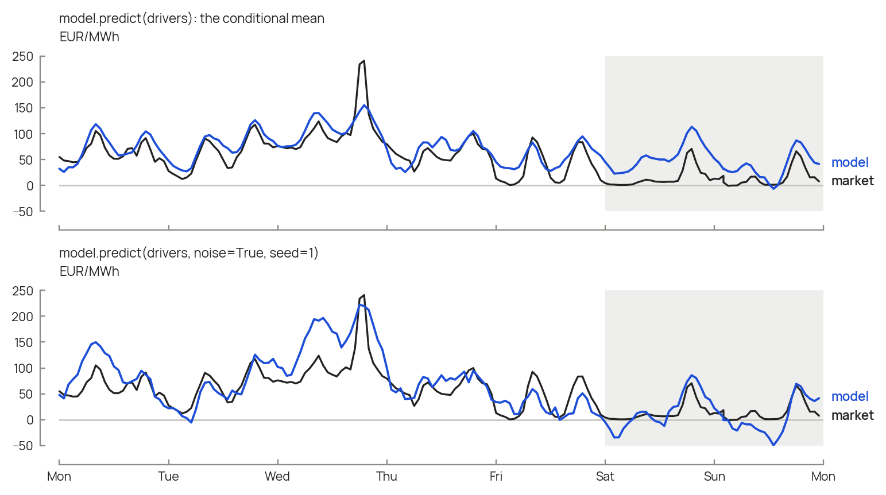
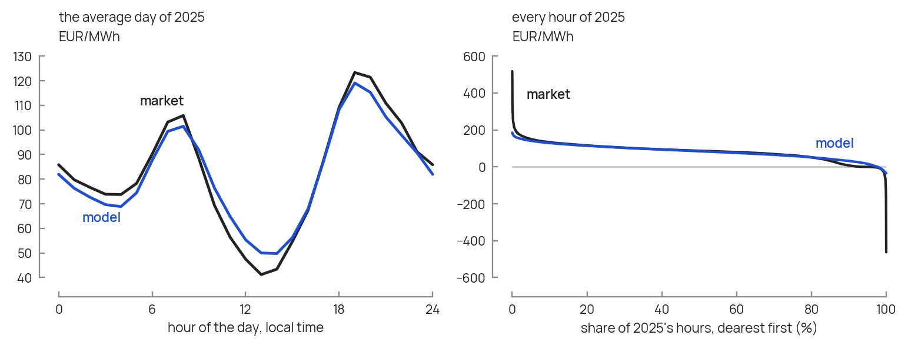

# Usage

## Data in

Everything takes pandas objects on an hourly `DatetimeIndex` (UTC, or
time-zone-naive and read as UTC):

- **prices**: a `Series` of day-ahead prices, EUR/MWh;
- **drivers**: a `DataFrame` (or a dict of `Series`) with columns `load`,
  `solar` and `wind`, in MW. Wind is onshore plus offshore.

`pricecast.entsoe.fetch_year(country, year)` returns both for one calendar year,
downloaded from the ENTSO-E Transparency Platform. It needs the optional
dependency and a free API token (as `token=` or the `ENTSOE_TOKEN` environment
variable):

```bash
pip install "pricecast[entsoe]"
```

### Getting a token

Downloading market data needs a free security token from the ENTSO-E
Transparency Platform. ENTSO-E's guide is
[How to get security token?](https://transparencyplatform.zendesk.com/hc/en-us/articles/12845911031188-How-to-get-security-token); in short:

1. Register an account on the [Transparency Platform](https://transparency.entsoe.eu/).
2. Email [transparency@entsoe.eu](mailto:transparency@entsoe.eu) with
   "Restful API access" as the subject and your registered email address in
   the body.
3. Once ENTSO-E has granted access, generate the
   token in your account settings.
4. Pass it as `token=`, or set it once as the `ENTSOE_TOKEN` environment
   variable. Keep it out of version control.

You only need a token to download data: the shipped models, `fit` on your own
series and everything else work without one.


## Fit, or start from a shipped model

```python
import pricecast

model = pricecast.fit([prices_2024, prices_2025], [drivers_2024, drivers_2025],
                      metadata={"country": "BE"})
model.to_json("be_2024_2025.json")

model = pricecast.load("BE")          # shipped: BE, DE, FR, ES, PL, fitted on 2024-25
pricecast.available()

# fitted on TYNDP 2026's hourly results for one target year: 2030, 2035, 2040, 2050
model = pricecast.load("BE", scenario="TYNDP2026", year=2040)
pricecast.available("TYNDP2026")      # (country, year) pairs
```

Every shipped model records in its `metadata` what the recipe needs without
its training data: the floor (`floor_eur_mwh`, the 1% quantile of the prices
fitted on), the share of training hours at or below it (`floor_share_pct`) and
the lowest net load fitted on (`lowest_net_load_mw`, for
`share_beyond_training`). A TYNDP model adds the scenario's solar and wind
fleet and annual demand (`drivers`), its load-weighted level over ordinary
hours (`level_eur_mwh`), the KPI dashboard's level and quantiles, and for 2035
and 2040 the demand and level of the lower- and higher-growth variants
(`variants`). See the [recipe](recipe.md) for how each is used.

## Generate

```python
year = model.predict(drivers)                       # the conditional mean
noisy = model.predict(drivers, noise=True, seed=1)  # with the residual process
```



*The conditional mean follows the market's daily rhythm but not its extreme
hours; the noise restores the spread, in hours of its own. The median week of
the home page, from the model fitted on 2023 and 2024. Over 2025 the noise lifts the
share of negative hours from 2.3 % to 5.2 % (market 5.9 %) and the daily
four-hour spread from 76 to 90 EUR/MWh (market 91), but its dips and spikes
fall in other hours than the market's.*

## Check the structure

```python
pricecast.structure_metrics(year, solar=drivers["solar"], heat=my_heat_demand)
pricecast.compare({"actual": prices_2025, "model": year}, truth="actual",
                  solar=drivers["solar"])
```

Reports the mean, the share of negative hours, the midday price over the mean,
the evening-minus-midday price, the solar value factor, the daily four-hour
spread and the heat-weighted price over the mean.



*The model keeps the shape of 2025's average day; what it misses are the
market's extreme hours. Left: the average day, whose morning and evening peaks
and midday trough the model places at the right hours. Right: every hour of the
year, dearest first. The market's few hours above 200 EUR/MWh and its plunge to
-462 EUR/MWh have no counterpart in the model, which is a conditional mean. The
model was fitted on 2023 and 2024.*

## A future year

The scenario sets the drivers and the level; the model sets the shape. Belgium
in 2030, with TYNDP 2026's fleet, demand and load-weighted mean price (see
[the recipe](recipe.md) and `examples/02_future_year.py`):

```python
future = pricecast.scale_drivers(drivers_2025, solar=1.40, wind=1.38, load=1.38)
floor = pricecast.training_floor(training_prices)
year = pricecast.rescale_to_level(model.predict(future), level=65.1, floor=floor,
                                  weights=future["load"])
print(pricecast.share_beyond_training(future, training_drivers))
```

## Sweeps and uncertainty

Each year takes a fraction of a second, so a scenario's inputs can be swept one
at a time or sampled together, one price year per sample. See
[Sweeps and uncertainty](uncertainty.md) and `examples/03_uncertainty.py`.
